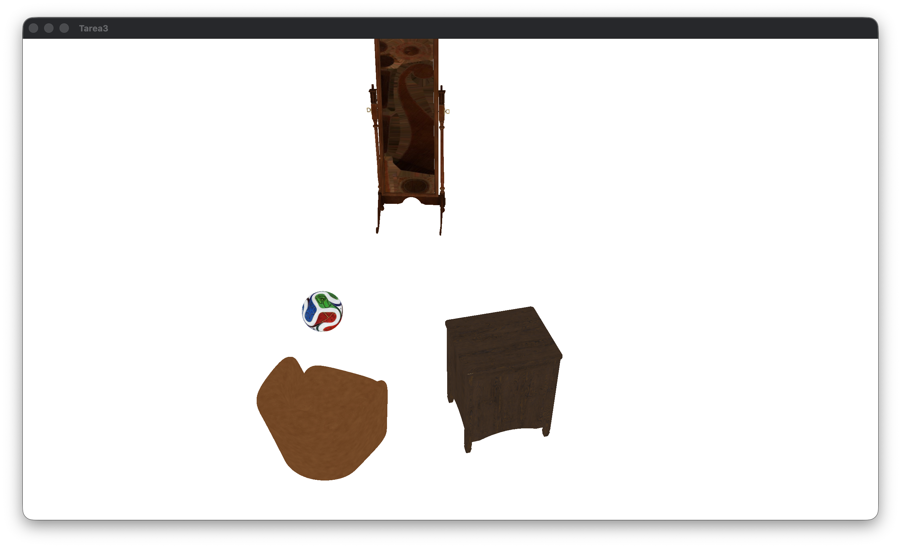
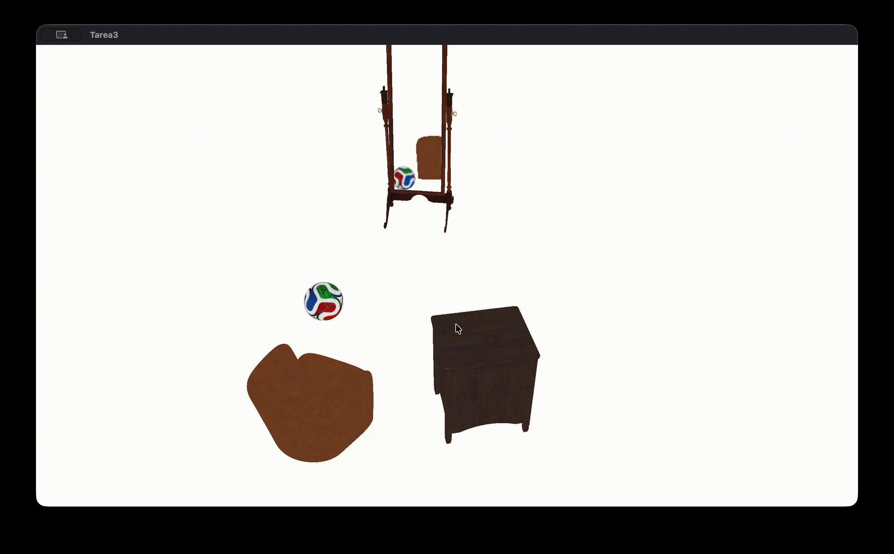

# Tarea 3: Escena con espejo

El objetivo de esta tarea es poner en práctica los conocimientos de renderizado sobre texturas en **OpenGL** que hemos estudiado recientemente. Para ello, completarán la implementación de una escena con un espejo.

Se provee el código base con la estructura y métodos necesarios. Únicamente deberán completar los siguientes elementos:

* **[src/Scene.cpp](./src/Scene.cpp)**:
  * En el método **render** : Se deberá completar el código necesario para renderizar la escena en una textura; posteriormente, se usará dicha textura en el plano para crear el espejo.

#### El único código que se debe añadir es al método **render**. Todo el demás código proporcionado está completo y es funcional


---

## Compilación y Ejecución

1. **Compilar el proyecto:**
   ```bash
   cmake -B build
   cmake --build build
   ```

2. **Ejecutar el programa:**
   * En Linux / macOS:
     ```bash
     ./build/Tarea3
     ```
   * En Windows (PowerShell / Command Prompt):
     ```bash
     ./build/Debug/Tarea3.exe
     # o ./build/Tarea3.exe según el generador de CMake usado
     ```

## Resultado esperado
### El código proporcionado genera la siguiente escena:



#### Al terminar la implementación, se espera que la escena funcione de la siguiente manera:


### Se puede hacer uso de las flechas del teclado (arriba y abajo) para mover la pelota por la escena. Además se tiene una cámara orbital controlada por el ratón.

---

## Entrega
* **Fecha límite:** [13/11/2026 a las 23:59 hrs]
* Enviar el enlace a su repositorio de GitHub con su solución.
* Por cada día de retraso se descontará 1 punto sobre la calificación final.

---
## Punto Extra - Blender:
Se adjunta la escena de Blender usada. Dichos modelos fueron exportados a un archivo obj y posteriormente cargados a la escena, se eliminó el uso del bounding box. Se puede obtener un punto extra si se crea una nueva escena de Blender.

---

## Dudas
Para cualquier duda o aclaración, contactar al correo: **ramarc2@ciencias.unam.mx**